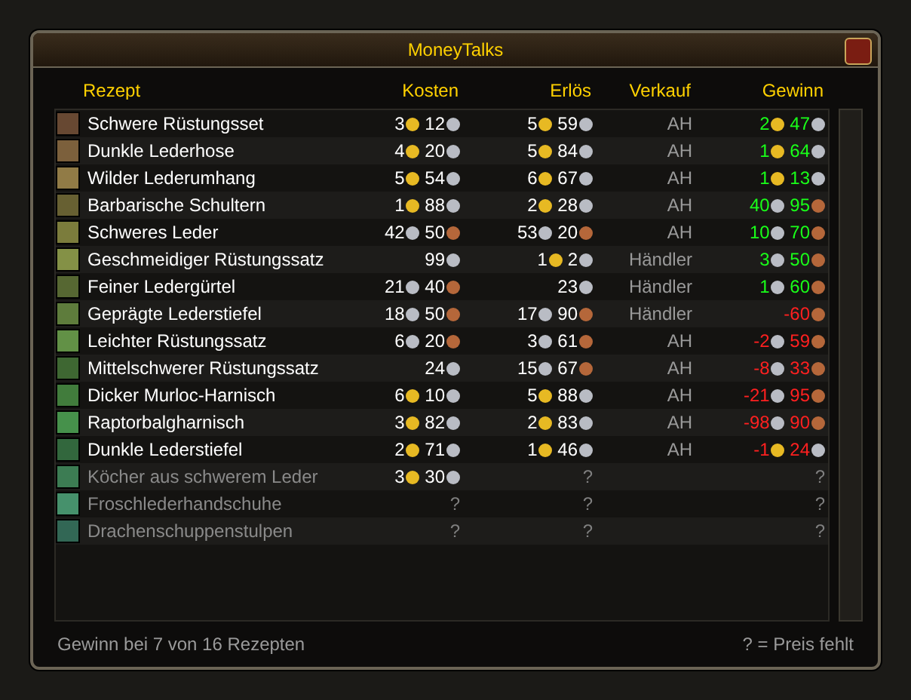

# MoneyTalks

Ein Addon für WoW Forever, das neben dem Berufsfenster zeigt, welche deiner Rezepte
Geld bringen und welche Geld kosten. Die Preise kommen von Auctionator.



*Nachgebaute Vorschau mit Beispieldaten, kein Spiel-Screenshot.*

## Die Liste lesen

Die Liste ist nach Gewinn sortiert, der beste Tipp steht oben.

| Spalte | Bedeutung |
|---|---|
| Kosten | Was alle Materialien zusammen kosten. Ist ein Material beim Händler billiger als im AH, zählt der Händlerpreis. |
| Erlös | Was das Endprodukt einbringt, über den besseren der beiden Wege. |
| Verkauf | `AH` oder `Händler`: wo du mehr bekommst. Beim AH sind die 5 % Gebühr schon abgezogen. |
| Gewinn | Erlös minus Kosten. Grün ist Gewinn, rot ist Verlust. |

- `?` heißt, dass ein Preis fehlt. Solche Rezepte stehen grau am Ende.
- Mit der Maus über einer Zeile siehst du die Kosten pro Material und beide Erlöse.
- Ein Klick auf eine Zeile zeigt das Rezept im Berufsfenster.
- `/moneytalks` (kurz `/mtalk`) blendet die Liste ein und aus.

## Installation

Voraussetzung ist das Addon [Auctionator](https://www.curseforge.com/wow/addons/auctionator).

**Mit WowUp:** Forever-Client wählen, dann „Install from URL" mit
`https://github.com/Dealwatch/wow_moneytalks`.

**Von Hand:** Unter [Releases](https://github.com/Dealwatch/wow_moneytalks/releases) das
Zip der neuesten Version laden und den Ordner `MoneyTalks` nach `Interface/AddOns`
entpacken, also neben den Ordner `Auctionator`.

Danach das Spiel komplett neu starten. Ein `/reload` erkennt neue Addons nicht.

## Woher die Preise kommen

- **AH-Preise** liest MoneyTalks aus Auctionators Datenbank. Auctionator füllt sie bei
  jedem Scan und jeder Suche im Auktionshaus. MoneyTalks scannt nichts selbst.
- **Aktuell halten:** In den Auctionator-Optionen (`/atr config`) unter „Allgemeine
  Optionen" den Autoscan beim Öffnen des Auktionshauses einschalten. Addons können
  AH-Preise nur lesen, solange das Auktionsfenster offen ist.
- **Einkaufspreise beim Händler** kennt Auctionator erst, nachdem du den Händler einmal
  besucht hast.
- **Verkaufspreise beim Händler** liefert das Spiel selbst für jedes Item.

## Bekannte Grenzen

- Der AH-Preis ist der niedrigste zuletzt gesehene Preis pro Stück. Ob genug davon im AH
  liegt und ob sich das Endprodukt verkauft, weiß das Addon nicht.
- Die Einstellgebühr im AH ist nicht eingerechnet. Sie geht verloren, wenn ein Item
  nicht verkauft wird.
- Zwischenprodukte werden zum AH-Preis gerechnet, nicht zu den eigenen Herstellkosten.
- Verzauberungen haben kein Endprodukt und zeigen nur Kosten.
- Die Texte sind nur auf Deutsch.

## Für Entwickler

- `MoneyTalks/Core.lua`: Rechenlogik ohne WoW-API.
- `MoneyTalks/UI.lua`: Fenster, Rezepte auslesen, Anbindung an Auctionator.
- `tests/core_test.lua`: prüft die Rechenlogik.
- `tests/ui_smoke_test.lua`: lädt die Oberfläche mit nachgebauter WoW-API und fängt
  Laufzeitfehler ab. Das Aussehen prüft er nicht.

Tests aus dem Repo-Root starten:

```bash
for t in tests/*_test.lua; do lua "$t"; done
```

**Neue Version veröffentlichen:**

1. In `MoneyTalks/MoneyTalks.toc` die Zeile `## Version:` hochzählen und nach `main` bringen.
2. Auf GitHub unter Actions den Workflow „Release" mit „Run workflow" starten.

Der Workflow führt die Tests aus, baut `MoneyTalks-v<Version>-forever.zip` und legt damit
ein GitHub-Release an. WowUp findet Forever-Addons auf GitHub nur über die Endung
`-forever.zip`.
