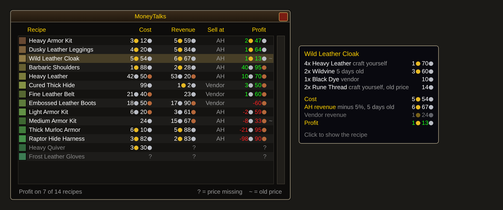

# MoneyTalks

A World of Warcraft: Forever addon that shows, next to the profession window, which of
your recipes make money and which lose money. Prices come from Auctionator.



*Mock preview with sample data, not an in-game screenshot. On the right is the tooltip of
the highlighted row.*

## Features

- Lists every learned recipe of the open profession, sorted by profit.
- Compares selling at the auction house with selling to a vendor and uses the better one.
- Prices each material by the cheapest route: auction house, vendor, or crafting it
  yourself, across several steps.
- Flags profits that rely on old auction house prices.
- German texts on a German client, English texts on every other client.

## Requirements

- World of Warcraft: Forever
- [Auctionator](https://www.curseforge.com/wow/addons/auctionator), which supplies the
  prices. Without it MoneyTalks does not load.

## Installation

**With WowUp:** select the Forever client, then use "Install from URL" with
`https://github.com/Dealwatch/wow_moneytalks`.

**By hand:** download the zip of the latest version from
[Releases](https://github.com/Dealwatch/wow_moneytalks/releases) and extract the
`MoneyTalks` folder into `Interface/AddOns`, next to the `Auctionator` folder.

Restart the game completely afterwards. A `/reload` does not pick up new addons.

## First steps

1. Open the auction house once so Auctionator has prices. To keep them fresh, turn on
   the autoscan in the Auctionator options (`/atr config`, basic options).
2. Open each of your professions once. MoneyTalks remembers their recipes.
3. The list appears next to the profession window whenever you open a profession.

## Reading the list

The list is sorted by profit, the best recipe is at the top.

| Column | Meaning |
|---|---|
| Cost | What all materials cost together, each by its cheapest route: auction house, vendor or crafting it yourself. |
| Revenue | What the product brings in, by the better of the two sale routes. |
| Sell at | `AH` or `Vendor`: where you get more. For the AH the 5% fee is already deducted. |
| Profit | Revenue minus cost. Green is a profit, red is a loss. |

- `?` means a price is missing. These recipes are greyed out at the end of the list.
- `~` after the profit means one of the auction house prices used is older than 3 days,
  so the profit is less reliable.
- Hover a row to see the cost of each material and both sale routes. A grey note after
  a material says where it is cheapest (`vendor`, `craft yourself`) and how old an old
  price is. The worse of the two sale routes is greyed out.
- Click a row to show the recipe in the profession window.

## Commands

| Command | Effect |
|---|---|
| `/moneytalks` or `/mtalk` | Shows or hides the list. |
| `/moneytalks reset` | Forgets the remembered recipes. Use it after unlearning a profession. |

## Intermediates

If you can craft a material for less than it costs at the auction house or a vendor,
MoneyTalks uses your crafting cost. This works across several steps, for example
Light Leather → Medium Leather → Heavy Leather.

For this the addon remembers, per character, the recipes of every profession you have
opened once. That is how it knows, for example, that you can smelt bars with Mining
while you have Blacksmithing open.

## Where the prices come from

- **Auction house prices** are read from Auctionator's database. Auctionator fills it
  with every scan and every search at the auction house. MoneyTalks does not scan.
- **Addons can only read auction house prices while the auction window is open.** A
  scan in the background or on a timer is not possible, so the list shows the prices
  from your last visit.
- **Vendor buy prices** are known to Auctionator only after you have visited that
  vendor once.
- **Vendor sell prices** come from the game itself for every item.

## Troubleshooting

| Problem | Cause and fix |
|---|---|
| The status line says no AH prices are available | Auctionator has no prices yet. Open the auction house and run a scan. |
| Many rows show `?` | Auctionator has never seen these items. Scan again, or search for the item at the auction house. |
| A material is not recognised as craftable | Open the profession that crafts it once, so its recipes are remembered. |
| "craft yourself" appears for a profession you dropped | Run `/moneytalks reset`, then open your professions again. |
| MoneyTalks does not load and the addon list reports a missing dependency | Auctionator is missing or disabled. |

## Known limits

- The auction house price is the lowest price last seen per item. The addon does not
  know whether enough of it is listed or whether the product actually sells.
- The auction house deposit is not included. You lose it when an item does not sell.
- Crafting a material yourself counts only its material cost, not your time.
- Intermediates are recognised only from this character's professions, not from alts.
- Enchants have no product item and show only their cost.

## Development

- `MoneyTalks/Core.lua`: the calculation, free of the WoW API.
- `MoneyTalks/Locale.lua`: German and English texts.
- `MoneyTalks/UI.lua`: the window, reading recipes, the link to Auctionator.
- `tests/core_test.lua`: checks the calculation.
- `tests/ui_smoke_test.lua`: loads the UI against a stubbed WoW API and catches runtime
  errors. It does not check how the UI looks.

Run the tests from the repository root (WoW uses Lua 5.1):

```bash
for t in tests/*_test.lua; do lua "$t"; done
```

**Publishing a new version:**

1. Raise `## Version:` in `MoneyTalks/MoneyTalks.toc` and get the change onto `main`.
2. On GitHub, open Actions and start the "Release" workflow with "Run workflow".

The workflow runs the tests, builds `MoneyTalks-v<version>-forever.zip` and creates a
GitHub release with it. WowUp finds Forever addons on GitHub only by the
`-forever.zip` suffix.
